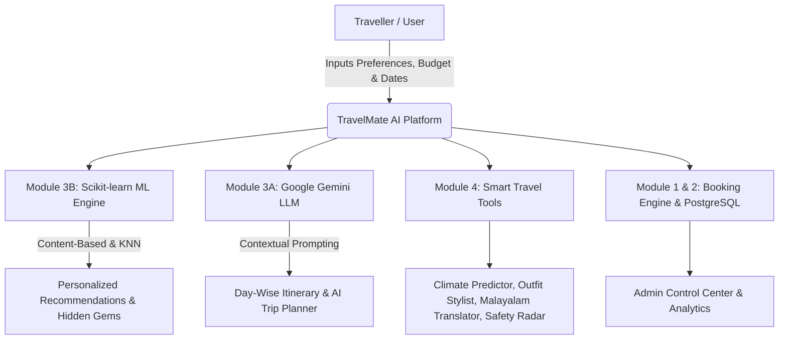
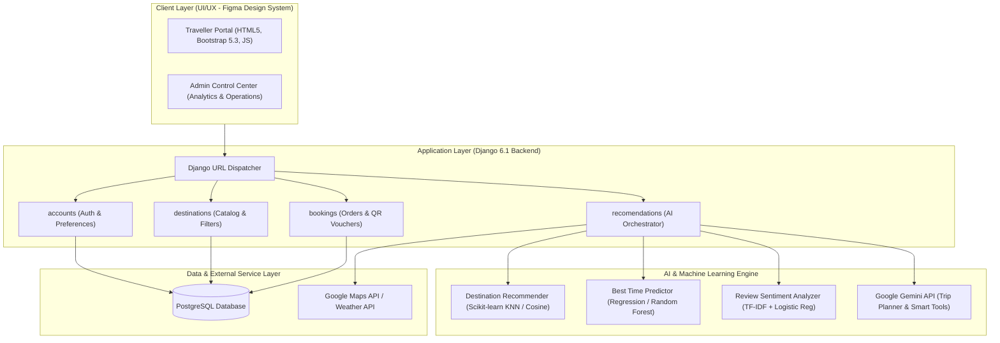
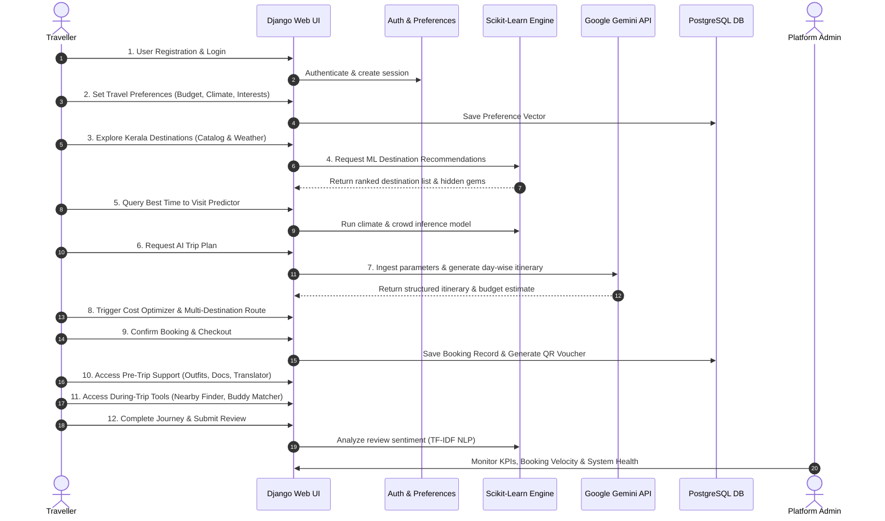
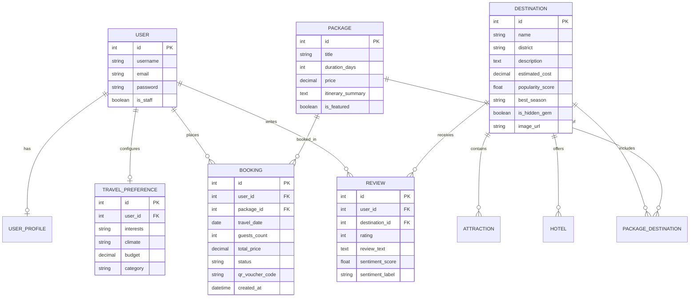

# PROJECT PROPOSAL
## **TravelMate AI: AI-Powered Travel Planning System**
### *“Explore More. Plan Smarter. Travel Better.”*

---

**Project Title:** TravelMate AI – Intelligent Dual-Dashboard Travel Planning & Recommendation Platform  
**Document Type:** Formal Project Proposal & Technical Specification Document  
**Project Group:** Group 6  
**Target Domain:** Travel & Tourism Technology, Artificial Intelligence, Machine Learning, Web Engineering  
**Academic / Engineering Framework:** Python Django, PostgreSQL, Scikit-learn, Google Gemini API, Bootstrap 5  
**UI/UX Design Specification:** [Figma Design Prototype (node-id: 0-1)](https://www.figma.com/design/8UWr5FFTUXRVMl0WpF5Zyi/Untitled?node-id=0-1&t=EmIKDTAYrMFuCgjy-0)

---

## 1. Executive Summary

TravelMate AI is a state-of-the-art, dual-dashboard web application engineered to solve the fragmented and cognitively exhausting nature of modern vacation planning. Traditional travel workflows force users to navigate disconnected platforms to discover locations, compare hotel expenses, schedule multi-point transportation, verify seasonal weather patterns, pack appropriately, overcome regional language barriers, and manage itinerary bookings.

TravelMate AI resolves these challenges through a unified platform featuring two distinct portals:
1. **The Traveller Portal:** A personalized dashboard allowing users to discover curated and offbeat destinations, configure customized travel parameters (budget, climate, interests), receive machine-learning-driven recommendations, interact with an AI Trip Planner powered by Google's Gemini Large Language Model (LLM), and access an 11-tool smart intelligence suite.
2. **The Admin Control Center:** An operational management suite enabling platform administrators to curate destination inventories, publish travel packages, audit eco-friendly accommodation tags, monitor customer bookings, assess crowd velocity, and review NLP-driven sentiment analytics.

Designed specifically with a modular architecture and validated through a high-fidelity Figma UI design system, TravelMate AI bridges advanced theoretical Machine Learning (Scikit-learn Content-Based Filtering, K-Nearest Neighbors, TF-IDF Sentiment Analysis, Regression Climate Predictors) with practical generative AI capabilities (Google Gemini API) into a cohesive, production-grade Django web application.

---

## 2. Problem Statement & Proposed Solution

### 2.1 The Problem
Vacation planning today suffers from severe cognitive overload and platform fragmentation:
- **Scattered Information:** Users spend hours toggling across search engines, review blogs, booking portals, and travel agency pamphlets.
- **Generic, Non-Personalized Recommendations:** Existing platforms promote sponsored or mass-market tourist traps rather than tailoring suggestions to individual constraints like climate preferences, budget thresholds, or crowd tolerance.
- **Complex Multi-Destination Logistics:** Organizing multi-stop circuits (such as a Kerala tour spanning Munnar, Thekkady, and Alappuzha) requires intricate calculations of transit times, seasonal peaks, and distributed budgets.
- **Lack of Real-Time In-Trip Assistance:** Once booked, travelers lack contextual tools for packing recommendations, emergency safety advisories, local dialect translations (e.g., Malayalam), and eco-footprint monitoring.

### 2.2 The Solution: TravelMate AI
TravelMate AI consolidates the entire travel lifecycle into three core pillars:
- **Intelligent Discovery:** Machine-learning algorithms analyze user preferences, previous journeys, and constraint vectors to recommend optimal destinations (including verified "hidden gems").
- **Dynamic AI Itinerary Synthesis:** Integration with the Gemini LLM generates time-slotted, budget-conscious, day-by-day travel schedules tailored to personal styles.
- **Smart On-Trip Copilot:** A comprehensive 11-feature AI utility toolkit addressing real-world travel pain points—from packing checklists and local dialect voice translation to emergency radar and carbon offset calculations.

---

## 3. User Personas & System Access Hierarchy

The system defines strict role-based access control (RBAC) separated into two primary roles:

| User Role | Access Point | Key Responsibilities & Capabilities |
| :--- | :--- | :--- |
| **Admin** | `/admin_dashboard/` | • Manage platform destinations, districts, and tags. • Curate and publish bundled travel packages. • Verify hotel accommodations and assign eco-friendly tags. • Review customer bookings, status transitions, and payments. • Monitor AI engine health, booking velocity, and sentiment reports. |
| **Traveller / User** | `/dashboard/` | • Manage personal profile, travel documents, and preferences. • Search and filter Kerala destinations by district and category. • Generate automated multi-day itineraries using Gemini AI. • Access the 11-tool AI Assistant suite. • Book destinations/packages and download digital QR vouchers. • Connect with compatible travel buddies and review past trips. |

---

## 4. UI/UX Design System Specification (Figma Mapping)

The user interface follows the design created in [Figma Prototype (8UWr5FFTUXRVMl0WpF5Zyi)](https://www.figma.com/design/8UWr5FFTUXRVMl0WpF5Zyi/Untitled?node-id=0-1&t=EmIKDTAYrMFuCgjy-0). The design emphasizes modern minimalism, accessibility, and high data density with pleasant visual hierarchy.

### 4.1 Design System Tokens & Aesthetics
- **Color Palette:**
  - **Brand Primary Dark:** `#173B57` (Deep Navy / Header, Sidebar, High-contrast headers)
  - **Brand Accent Teal:** `#20A69A` (Vibrant Turquoise / Primary CTAs, active pills, indicators)
  - **Surface Secondary:** `#EBF6F5` (Soft Aqua-Mint tint for active badges & highlight cards)
  - **Canvas Neutral:** `#F5F8FA` (Cool grey-white app background for reduced eye strain)
  - **Card Surface:** `#FFFFFF` (Pure white card surfaces with `0px 4px 20px rgba(0,0,0,0.06)` drop shadows)
  - **Semantic Accents:** Amber `#F59E0B` (High demand/ratings), Emerald `#10B981` (Confirmed/Low carbon), Crimson `#EF4444` (Emergency/SOS alerts)
- **Typography:** Modern clean sans-serif (`Inter`, `System-UI`, `Segoe UI`), with distinct typographic scales for hero display headers, card subtitles, and compact metadata badges.
- **Layout Grid:** Responsive desktop dual-column layout (fixed 260px navigation sidebar + fluid content container) with adaptive bottom navigation bar for mobile viewports.

---

### 4.2 Comprehensive Screen-by-Screen UI Specification

#### **Screen 1: Traveller Dashboard (`/dashboard/`)**
*The central command center for authenticated users.*
- **Top Navigation Bar:** Brand logo `TravelMate AI`, role switch pill (`Traveler` / `Admin Portal`), global search bar, notification bell with unread indicators, and user avatar profile chip (`Rahul`).
- **Sidebar Suite:** Collapsible dual-section navigation menu:
  - *Traveller Suite:* Dashboard (Active), Explore Destinations, AI Trip Planner, AI Assistant (11 Tools), My Bookings, Travel History, Safety & Utilities, Profile.
  - *Admin Operations:* Quick link to Admin Portal for privileged accounts.
- **Welcome & Discovery Hero:** Warm personalized banner (*"Welcome back, Rahul - Explore More. Plan Smarter. Travel Better."*) with natural-language route query input (*"Where next? e.g. 4-day road trip in Kerala"*) accompanied by quick search chips (*Kerala Backwaters, Hill Stations, Beach Getaway*).
- **Upcoming Trip Monitor Card:** Displays real-time progress for active itineraries (*"Munnar & Tea Hills Trek • 4 Days / 3 Nights • 4 Days Left"*), route breakdown (*Tea Valley Top Station Circuit*), and an interactive **Trip Expense Pool** meter showing real-time spend vs budget limit (*Spent ₹14,200 of ₹25,000*).
- **Smart Expeditions Quick Access:** 4 circular shortcut tiles linking directly to core smart utilities (*Best Time, Cost Optimizer, Safety & Alerts, Hidden Spots*).
- **Featured Kerala Carousel:** High-resolution card grid displaying top destinations (*Munnar Hill Station - 4.8★ ₹8,300*, *Wayanad Nature Sanctuary - 4.7★ ₹7,200*).
- **Interactive "Ask TravelMate AI" Copilot Widget:** Direct in-page conversational prompt box connected to Gemini API with suggested quick-inquiries (*"What to pack for Munnar trek this weekend?", "Top quiet tea estate homestays with views?", "Authentic local Kerala fish curry stops en route"*).
- **Live Booking Voucher Card:** Active booking confirmation (*"Cloud Valley Plantation Retreat - Tea Valley Road, Munnar"*) complete with check-in timestamps, guest headcount, booking reference code, verified badge, downloadable PDF voucher CTA, and scannable QR ticket preview.

---

#### **Screen 2: Kerala Destination Explorer & Catalog (`/destinations/`)**
*A rich exploration engine tailored for South India & Kerala destinations.*
- **Dynamic Weather Search Header:** Integrated search bar presenting live atmospheric telemetry for key hubs (*"Munnar 18°C Sunny"*, *"Alappuzha 28°C Breeze"*).
- **District & Category Filter Ribbon:** One-click horizontal filter chips for all prime Kerala districts (*All Districts, Wayanad, Alappuzha, Munnar/Idukki, Palakkad, Athirappilly, Vagamon*) and travel typologies (*Hill Station, Backwaters, Wildlife Sanctuary, Historic*).
- **Sorting & Metrics Toolbar:** Live count of matching destinations with sorting dropdown (*Popularity: High to Low, Price: Low to High, Crowd Density*).
- **Detailed Destination Cards:**
  1. **Munnar:** Rating 4.8★ (2.4k reviews) • Highlights: Eravikulam, Mattupetty, Tea Museum • Demand: 94% High Demand (Peak Season) • Price: ₹8,500 / 3 days.
  2. **Alappuzha:** Rating 4.9★ (3.1k reviews) • Highlights: Houseboat Cruise, Marari Beach, Pathiramanal • Demand: 92% Fast Selling • Price: ₹11,000 / 2 days.
  3. **Wayanad:** Rating 4.7★ (1.8k reviews) • Highlights: Banasura Sagar, Chembra Peak, Edakkal Caves • Flow: 89% Steady Flow • Price: ₹7,200 / 3 days.
  4. **Vagamon:** Rating 4.6★ (920 reviews) • Highlights: Pine Forest, Kurisumala, Meadows • Status: 76% Hidden Gem (Off-Season) • Price: ₹5,500 / 2 days.
  5. **Thekkady:** Rating 4.8★ (1.9k reviews) • Highlights: Periyar Reserve, Spice Garden, Bamboo Rafting • Demand: 91% Trending Now • Price: ₹9,000 / 3 days.
  6. **Athirappilly:** Rating 4.7★ (1.4k reviews) • Highlights: Athirappilly Falls, Vazhachal Falls, Rainforest Trek • Weekend Favorite • Price: ₹4,500 / 1 day.
- **Sticky Bottom Copilot Bar:** Persistent floating callout: *"Need a custom trip plan? Let AI craft an itinerary across Kerala"* with one-click `[Launch Planner]` modal trigger.

---

#### **Screen 3: AI Travel Intelligence Hub (`/assistant/`)**
*The comprehensive showcase of 11 dedicated AI & Machine Learning micro-modules.*
- **System Vitality Ribbon:** Diagnostic bar highlighting active status (*11/11 Live • 98.6% Accuracy • 420ms Avg Response*).
- **Module Filter Tabs:** Categorized switches: `[All Tools (11)]`, `[Planning]`, `[Budget & Reviews]`, `[Local Assistance & Safety]`.
- **Spotlight Feature – Munnar 48-Hour Generator:** Visual timeline breakdown for an automated two-day expedition with costs (*06:00 AM Kolukkumalai Sunrise Safari ₹1,400*, *10:30 AM Eravikulam Alpine Track ₹300*, *04:00 PM Pothamedu Sunset Deck Free*) and an exportable PDF plan button.
- **The 11 Smart Feature Cards:**
  1. **Smart Destination Recommender (ML):** Scikit-learn content engine evaluating past traveler clusters against current preferences (`[Solo Trip]`, `[Cool Climate]`, `[₹15,000 Budget]`).
  2. **AI Trip Planner (Gemini LLM):** Multi-day, multi-destination route synthesizer balancing morning, afternoon, and sunset slots.
  3. **Best Time to Visit Predictor (ML):** Interactive seasonal graph cross-referencing rainfall, humidity, and peak crowd curves to recommend optimal visit months.
  4. **Hidden Tourist Places Finder (ML):** Filters destination databases for seclusion indicators (Crowd density < 15%) to spotlight spots like *Vagamon Pine Ridge* and *Muthanga Bamboo Arc*.
  5. **Travel Buddy Matching (ML):** Cosine-similarity social matching calculating compatibility percentages (e.g., *Adari H. - 94% Compatibility*).
  6. **Tourist Review Sentiment Analysis (NLP):** TF-IDF & classification engine analyzing reviews into positive/neutral/negative breakdowns with sentiment breakdown (86% Positive).
  7. **AI Travel Cost Optimizer (ML + LLM):** Comparative financial analysis contrasting luxury resorts with verified boutique homestays (saving up to ~32%).
  8. **AI Outfit & Packing Stylist (LLM):** Synchronizes destination forecasts to formulate weather-specific apparel checklists (e.g., high-altitude windproof fleece and mud-traction footwear).
  9. **Malayalam & Dialect Voice AI (API/LLM):** Contextual phrase translator equipped with pronunciation and situational etiquette (e.g., *"Ethra aayi?"* / *“How much does this cost?”*).
  10. **Sustainable Travel Recommender (Rules + LLM):** Real-time carbon estimation tracking kg CO2e footprints and awarding eco-friendly badges.
  11. **Safety Score & Emergency Radar (Data + LLM):** 24/7 monitored safety dashboard displaying landslide hazards, hospital proximities, and one-tap emergency SOS contacts.
- **Bottom Copilot Action Ribbon:** Master CTA triggering a global context handover (*"Tailor All 11 Tools for Your Next Trip - Launch Full AI Copilot"*).

---

#### **Screen 4: Admin Control Center (`/admin_dashboard/`)**
*Comprehensive operational analytics and management interface.*
- **Live System KPI Cards:**
  - **Total Platform Users:** `38,420` (`+12.4% MoM`)
  - **Active Destinations:** `142` (`4 Added for Quality Check`)
  - **Package Bookings:** `64` (`13 Premium Specials`)
  - **Gross Revenue Fulfillment:** `₹2.84M` (`98.2% Fulfillment Rate`)
- **Quick Operations Bar:** Immediate administrative shortcuts (`[+ Add Destination]`, `[+ Create Package]`, `[Verify Reviews]`).
- **Booking Velocity Chart:** Monthly comparative column chart tracking transaction volume from January through June.
- **Destination Market Share Distribution:** Circular/bar breakdown: Munnar Backwaters (38%), Wayanad Forest Haven (24%), Thekkady Reserves (22%), Varkala Cliff Beach (16%).
- **Recent Live Bookings Audit Table:** Detailed live transactions logging customer name, package title, amount paid, and live fulfillment state (`Confirmed` / `Pending`).
- **AI Engine Health Monitor:** Technical diagnostics panel displaying system uptime (`99.98%`), API response latency (`340ms`), and active model allocations (`12 Live / 2 Fallback`).

---

## 5. System Architecture & Technical Specifications

### 5.1 Technology Stack Details
- **Frontend Presentation:** HTML5, CSS3, Modern Bootstrap 5.3, Vanilla JavaScript (ES6+), FontAwesome / Bootstrap Icons.
- **Backend Application Server:** Python 3.14 with Django 6.1 web framework (WSGI / ASGI).
- **Relational Database:** PostgreSQL (production-grade persistence for users, bookings, packages, and destinations).
- **Machine Learning Core:** Scikit-learn, Pandas, NumPy, Joblib (model serialization).
- **Generative AI Engine:** Google Gemini API (`gemini-1.5-flash` / `gemini-pro`) configured for structured JSON and markdown stream generation.
- **External Web APIs:** Google Places API, Google Maps Distance Matrix API, OpenWeatherMap API, Google Translate API.

---

## 6. Detailed System Modules

### Module 1: Admin & Destination Management
- **Destination & Category Inventory:** CRUD management of districts, tourist spots, coordinates, descriptions, elevation, and high-resolution imagery.
- **Travel Package Management:** Grouping individual attractions into pre-packaged 2-day to 5-day itineraries with fixed pricing and tiered accommodations.
- **Eco-Friendly Accommodation Auditing:** Tagging hotels and homestays with sustainability certifications (e.g., Solar Powered, Zero Plastic, Farm-to-Table, Indigenous Owned).
- **Booking & Revenue Oversight:** Auditing customer checkout status, generating financial reports, and resolving cancellations.
- **Review Moderation & Sentiment Insights:** Aggregating tourist feedback and viewing NLP sentiment heatmaps.

### Module 2: User & Travel Management
- **Authentication & Secure Profiles:** Registration, login, session management, and password recovery via Django Authentication.
- **User Preference Profiling:** Storing multidimensional user preferences including budget bracket, climate affinity (Cool, Warm, Tropical), interest tags (Adventure, Heritage, Beach, Wildlife), and travel styles (Solo, Family, Group).
- **Search & Multi-Filter Engine:** Dynamic real-time querying by district, weather, price, and category.
- **Digital Booking & Itinerary Management:** Confirming destination bookings and generating downloadable digital PDF tickets equipped with verification QR codes.
- **Travel History & Bookmarks:** Tracking completed journeys and saving wishlisted locations.

### Module 3: Core AI & ML Features
- **A. AI Trip Planner (Google Gemini API LLM):**
  - Collects user dates, party size, budget, and selected Kerala spots.
  - Generates time-slotted, realistic day-by-day itineraries including transit times, dining recommendations, and activity durations.
  - Provides a conversational Q&A interface for itinerary alterations (*"Make day 2 more relaxing"*).
- **B. Destination Recommendation System (Scikit-Learn ML):**
  - Uses Content-Based Vectorization and K-Nearest Neighbors (KNN) to score candidate destinations against user preference vectors.
  - Calculates cosine similarity across continuous features (budget, duration) and categorical features (interests, climate).

$$\text{Similarity}(u, d) = \frac{\vec{u} \cdot \vec{d}}{\|\vec{u}\| \|\vec{d}\|}$$

### Module 4: Smart Travel Features (11 AI & Utility Tools)

| # | Smart Feature | Functional Description | Architecture / Implementation | Type |
| :- | :--- | :--- | :--- | :--- |
| **1** | **Best Time to Visit Predictor** | Evaluates historical monthly precipitation, temperature, and crowd density to predict the optimal travel month. | Scikit-learn Random Forest / Decision Tree regressor trained on historical weather & tourist influx datasets. | **ML** |
| **2** | **Hidden Tourist Places Finder** | Surfaces lesser-known, low-crowd destinations based on interest matching. | Content-based recommender filtering with a low-popularity threshold ($\text{Popularity Score} \le 0.30$). | **ML** |
| **3** | **Travel Buddy Matching** | Connects solo explorers with verified travelers embarking on similar routes and dates. | K-Nearest Neighbors & Cosine Similarity on user interest vectors and safety verification scores. | **ML** |
| **4** | **Tourist Review Sentiment Analysis** | Parses hundreds of customer reviews to extract positive/negative polarity scores and sentiment summaries. | Scikit-learn TF-IDF Vectorizer coupled with Multinomial Naive Bayes / Logistic Regression. | **ML / NLP** |
| **5** | **AI Travel Cost Optimizer** | Compares transportation modes, homestays vs resorts, and ticket passes to suggest actionable savings. | Machine learning cost-prediction baseline paired with Gemini prompt optimization suggestions. | **ML + LLM** |
| **6** | **AI Outfit & Packing Stylist** | Delivers weather-synchronized clothing checklists and activity gear recommendations. | Live OpenWeatherMap API telemetry ingested into a prompt template processed by Gemini API. | **LLM** |
| **7** | **Malayalam & Dialect Translator** | Translates survival phrases, transport queries, bargaining slang, and food allergen alerts. | Google Gemini API with regional phonetic transliteration and English explanations. | **LLM / API** |
| **8** | **Sustainable Travel Recommender** | Calculates carbon footprint estimates and highlights eco-certified homestays and public transit alternatives. | Database eco-tag filters + carbon estimation heuristic equation + Gemini eco-travel advisory. | **LLM + Rules** |
| **9** | **AI Travel Safety Score & Radar** | Delivers real-time district hazard advisories, night travel feasibility, and emergency medical hubs. | Aggregated district incident data + Google Gemini situational analysis + emergency contacts database. | **LLM + Data** |
| **10**| **Nearby Places Finder** | Pinpoints local ATMs, hospitals, pharmacies, vegetarian/halal eateries, and fuel stations. | Google Maps Places API / Nearby Search REST endpoints. | **API (Utility)** |
| **11**| **Travel Document & Checklist Reminder** | Tracks passport, ID, permit expirations and creates departure checklist notifications. | Django background tasks with date validation triggers and dashboard notifications. | **Utility (System)** |
| **+** | **Multi-Destination Kerala Route Explorer** | Calculates route distances, travel durations, and consolidated budgets across Kerala districts (Munnar, Wayanad, Palakkad, Athirappilly, Alappuzha). | Google Maps Distance Matrix API + custom route optimization algorithm. | **API (Utility)** |

---

## 7. Complete System Workflow (12 Steps)

---

## 8. Database Schema Design (Entity-Relationship Blueprint)

---

## 9. Implementation Roadmap & Project Phases

| Phase | Milestone Name | Work Breakdown | Key Deliverables |
| :--- | :--- | :--- | :--- |
| **Phase 1** | **Core Foundation & Dual Dashboards** | • Setup Django project, PostgreSQL connection, and base templates. • Implement authentication, user registration, and role separation. • Build User Dashboard (`/dashboard/`) and Admin Dashboard (`/admin_dashboard/`) adhering to Figma specifications. • Implement destination catalog and basic booking flow. | Working core web portal with active Figma styling tokens and functional database models. |
| **Phase 2** | **Core AI & ML Integration** | • Curate and preprocess Kerala destination dataset (features: budget, climate, activities, crowd level). • Train Scikit-learn Content-Based Recommender and KNN models; export using Joblib. • Integrate Google Gemini API client into Django view pipeline. • Implement interactive day-by-day AI Trip Planner. | Personalized recommendations on dashboard and generative itinerary planner. |
| **Phase 3** | **Specialized ML Add-ons** | • Train Best Time to Visit Predictor using seasonal climate/crowd data. • Build Hidden Tourist Places filtering module ($\text{Popularity} \le 0.30$). • Build Travel Buddy Matching algorithm (Cosine distance on user vectors). • Train NLP Review Sentiment Analyzer (TF-IDF + Logistic Regression). | 4 distinct trained machine-learning microservices operational in Django. |
| **Phase 4** | **Generative AI & LLM Add-ons** | • Build AI Outfit & Packing Stylist prompt templates synced to Weather API. • Implement Malayalam & Dialect Voice/Text Translator. • Construct AI Travel Cost Optimizer (budget saving strategies). • Develop Sustainable Travel & Eco-Footprint scoring module. • Configure Safety Score & Emergency Radar views. | All 11 tools fully operational on the AI Travel Intelligence Hub (`/assistant/`). |
| **Phase 5** | **Utility Tools, Security & Deployment** | • Connect Google Maps Places & Distance Matrix APIs. • Implement Multi-Destination Kerala Route Explorer. • Implement Document Expiry & Checklist notification tasks. • Conduct end-to-end testing, security validation, and cloud deployment (Render/VPS). | Fully deployed, production-ready TravelMate AI platform with complete documentation. |

---

## 10. Key Project Benefits & Innovation Highlights

1. **Integrated All-in-One Travel Ecosystem:** Eliminates 8+ fragmented applications by uniting discovery, itinerary generation, cost optimization, and safety alerts under one roof.
2. **True Hybrid AI Architecture:** Seamlessly merges deterministic Machine Learning (for accurate, fast, cold-start destination scoring and sentiment filtering) with Generative LLMs (for natural-language, flexible day-by-day itineraries).
3. **Hyper-Localized for Kerala Tourism:** Specific data models and curated attraction inventories covering Alappuzha, Athirappilly, Palakkad, Wayanad, Munnar, Vagamon, and Thekkady.
4. **Figma Design System Fidelity:** Professional, modern UI/UX featuring high visual polish, clean information density, dynamic weather cards, and accessible dual-role interfaces.
5. **Sustainable & Responsible Tourism:** Active tracking of carbon emissions, highlighting of low-impact community homestays, and promotion of offbeat destinations to counteract overtourism.

---

## 11. Presentation Elevator Pitch (30 Seconds)

> *“Our project, **TravelMate AI**, is an intelligent, dual-dashboard travel planning web application designed to eliminate the complexity and fragmentation of vacation planning.*
> 
> *The system features an **Admin Control Center** for managing destinations, packages, and bookings, and an intuitive **Traveller Portal** aligned with our custom Figma design system.*
> 
> *Using **Scikit-learn Machine Learning**, TravelMate AI delivers personalized destination recommendations, predicts the best months to visit, analyzes review sentiment, and pairs compatible travel buddies. Concurrently, **Google's Gemini LLM** synthesizes day-by-day itineraries and powers smart travel tools—including weather-synced outfit recommendations, real-time safety scores, a Malayalam dialect translator, and multi-destination Kerala trip planning.*
> 
> *TravelMate AI empowers travellers to explore more, plan smarter, and travel better.”*

---

## 12. Viva / Defense Anticipated Questions & Answers

**Q1: Why use both Machine Learning (Scikit-learn) and an LLM (Gemini) instead of just prompting Gemini for everything?**  
*Answer:* Generative LLMs are prone to hallucinations, cannot reliably execute mathematical distance/cost optimizations, and incur high API latency and cost when used for simple classification. In TravelMate AI, Scikit-learn handles fast, deterministic tasks—like computing cosine similarity for recommendations, regression on historical climate data, and TF-IDF review classification. Gemini is reserved for high-value generative reasoning—like synthesizing contextual multi-day itineraries and natural conversational assistance.

**Q2: How does the system handle the 'Cold Start' problem for new users with no travel history?**  
*Answer:* When a user registers, they complete an onboarding Travel Preference form (specifying budget, climate preference, and preferred category: Nature, Hill Station, Beach, etc.). The Scikit-learn Content-Based Recommender calculates similarity against destination feature vectors directly, providing accurate suggestions from day one without requiring prior booking logs.

**Q3: How does the Figma design translate into the Django frontend?**  
*Answer:* The Figma design tokens (Palette: `#173B57` Navy, `#20A69A` Teal; typography; border-radii: 14–16px; card shadows) are implemented in Django's global static CSS file (`style.css`) and modular template hierarchy (`base.html`, `dashboard.html`, `destination_list.html`). The four Figma frames map directly to Django view routes: Traveller Dashboard (`/dashboard/`), Destinations Explorer (`/destinations/`), AI Intelligence Hub (`/assistant/`), and Admin Control Center (`/admin_dashboard/`).
